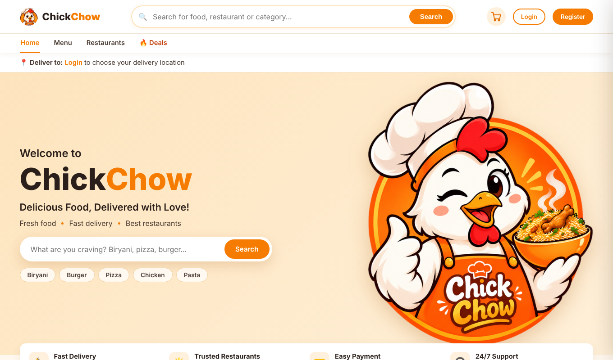
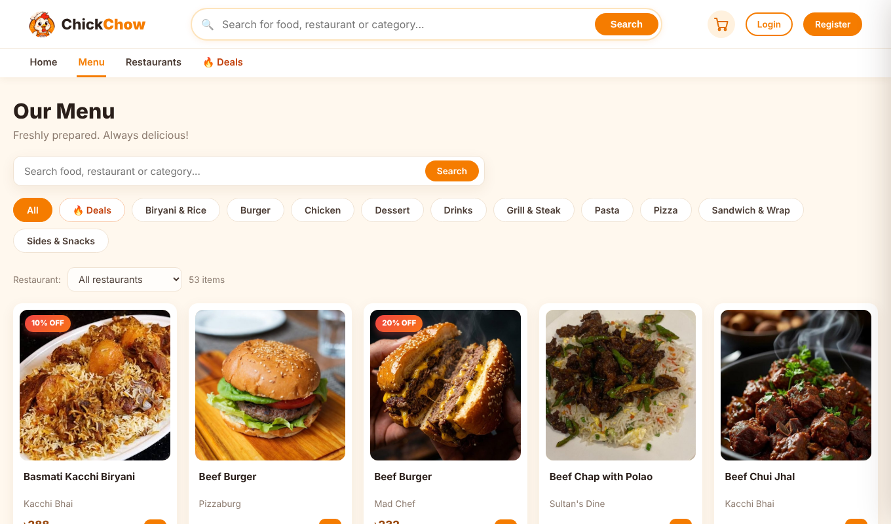
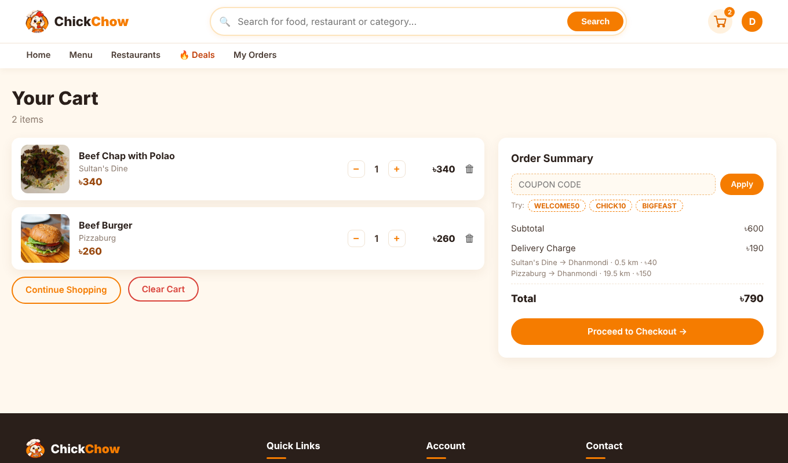
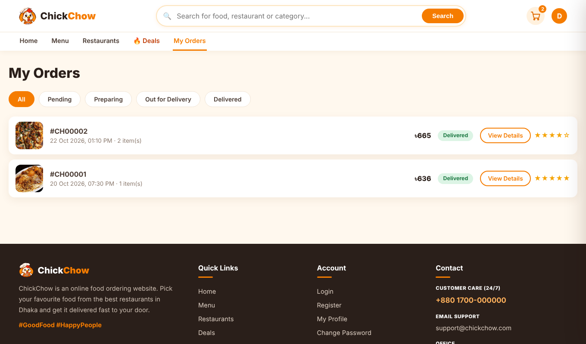
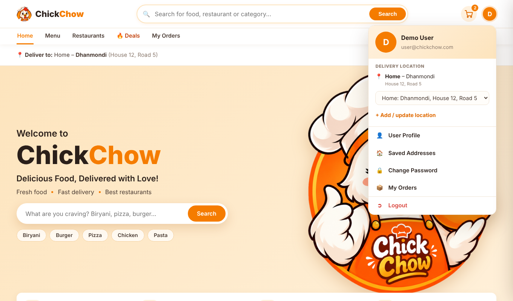
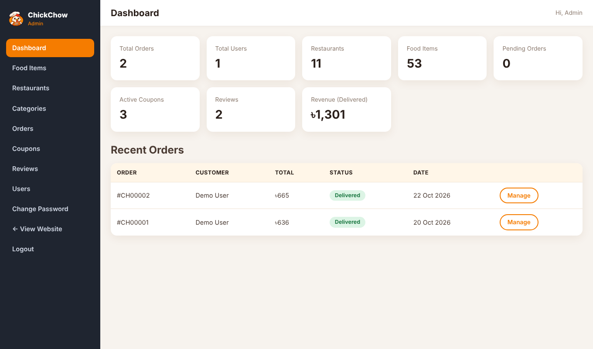
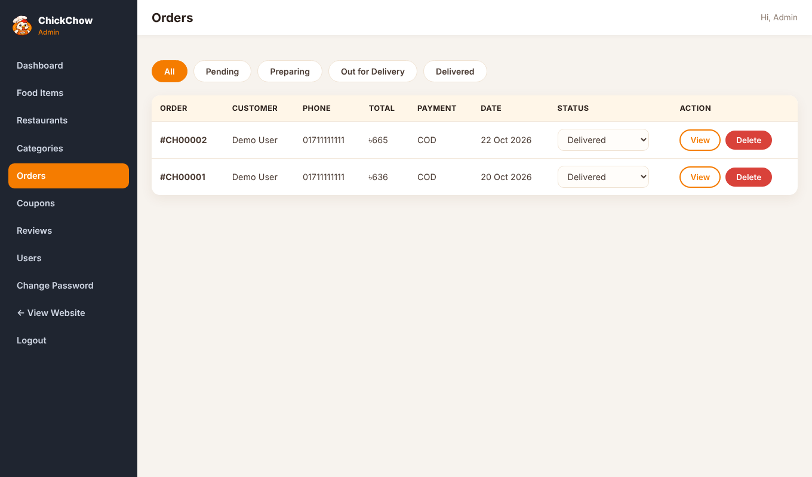
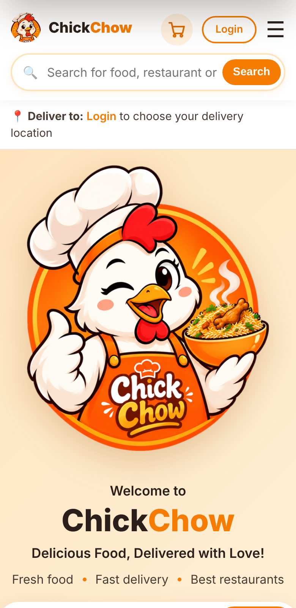
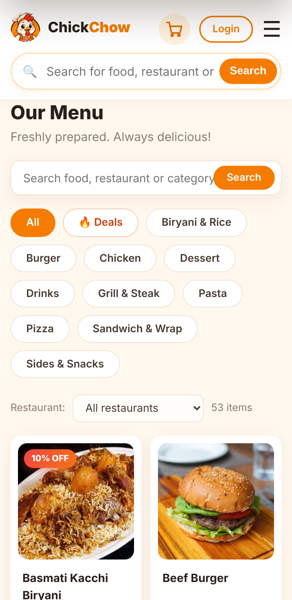

<div align="center">

# 🍗 ChickChow

### Online Food Ordering System

Order delicious food from the best restaurants in Dhaka, track it live, and manage everything from a powerful admin panel.


**[🌐 Live Demo](https://chickchow-food.vercel.app)**



</div>

---

## 📖 About

**ChickChow** is a full-stack online food ordering website built as a solo project for the course
**Web Technologies and Programming Lab (CSE 06132228)** at **World University of Bangladesh**.
Customers can browse restaurants, add food to the cart, apply coupons, choose a delivery area and
place orders. Restaurant owners and admins manage the whole system from a clean admin panel.

## ✨ Features

### 👤 Customer
| | |
|---|---|
| 🔐 **Account** | Register, login, profile, saved addresses, change password |
| 🍔 **Browse** | Restaurants, categories, search and filters, special deals |
| 🛒 **Cart** | AJAX cart drawer (no page reload), quantity update |
| 🎟️ **Coupons** | Percent and fixed discounts with minimum order rules |
| 📍 **Delivery** | Delivery charge by distance across 24 Dhaka areas |
| 📦 **Orders** | Live tracking: Pending → Preparing → Out for Delivery → Delivered |
| ⭐ **Reviews** | Rate and review after the order is delivered |

### 🛠️ Admin
| | |
|---|---|
| 📊 **Dashboard** | Sales and order summary at a glance |
| 🍽️ **Manage** | Food items, restaurants, categories, coupons, users |
| 🧾 **Orders** | View and update order status |
| 💬 **Reviews** | Monitor and moderate customer reviews |
| 🔑 **Security** | Change admin password from the panel |

### 🔒 Security
Hashed passwords (`password_hash`), prepared statements (PDO), CSRF tokens, output escaping,
safe image upload checks, DB transactions at checkout, separate user and admin sessions.

## 📸 Screenshots

<table>
  <tr>
    <td align="center"><b>Menu</b><br></td>
    <td align="center"><b>Cart</b><br></td>
  </tr>
  <tr>
    <td align="center"><b>Order tracking</b><br></td>
    <td align="center"><b>User menu</b><br></td>
  </tr>
  <tr>
    <td align="center"><b>Admin dashboard</b><br></td>
    <td align="center"><b>Admin orders</b><br></td>
  </tr>
</table>

<div align="center">

**📱 Fully responsive: laptop, tablet and phone**

 &nbsp; 

</div>

## 🧰 Tech Stack

| Layer | Technology |
|---|---|
| Backend | PHP 8 (PDO) |
| Database | MySQL / MariaDB (9 tables, foreign keys) |
| Frontend | HTML5, plain CSS, AJAX (fetch) |
| Hosting | Vercel (PHP runtime) + TiDB Cloud (MySQL) |
| Local server | XAMPP |

## 🗂️ Project Structure

```
chickchow/
├── admin/        Admin panel pages
├── api/          Vercel entry point (index.php)
├── assets/       CSS, JS and images
├── config/       Database connection (reads environment variables)
├── database/     SQL files (local + cloud)
├── includes/     Header, footer, helpers, shared forms
├── *.php         Customer pages (menu, cart, checkout, orders ...)
└── vercel.json   Vercel configuration
```

## 🚀 Getting Started

### Run locally (XAMPP)
1. Start **Apache** and **MySQL** in XAMPP.
2. Copy this folder to `C:\xampp\htdocs\chickchow`.
3. Open **phpMyAdmin** → **Import** → choose `database/chickchow.sql`.
4. Open `http://localhost/chickchow`.

### Deploy online (Vercel + TiDB Cloud)
1. Create a free MySQL database on **TiDB Cloud** and run `database/chickchow_cloud.sql` in its SQL Editor.
2. Import this repository in **Vercel** (Preset: *Other*).
3. Add these **Environment Variables**:

   | Key | Value |
   |---|---|
   | `DB_HOST` | your database host |
   | `DB_PORT` | `4000` |
   | `DB_NAME` | `test` |
   | `DB_USER` | your database user |
   | `DB_PASS` | your database password |
   | `DB_SSL` | `1` |

4. Click **Deploy**. No password is stored in the code.

## 👩‍💻 Developer

**Nusrat Jahan Labonno**
Roll 4572 · ID WUB 03/25/69/4572 · Batch 69C · Semester 6th
Department of Computer Science and Engineering, **World University of Bangladesh**

**Submitted to:** Kh. Mustafizur Rahman, Senior Lecturer, Dept. of CSE

---

<div align="center">

Made with ❤️ and 🍗 by Nusrat Jahan Labonno · © 2026 ChickChow

</div>
