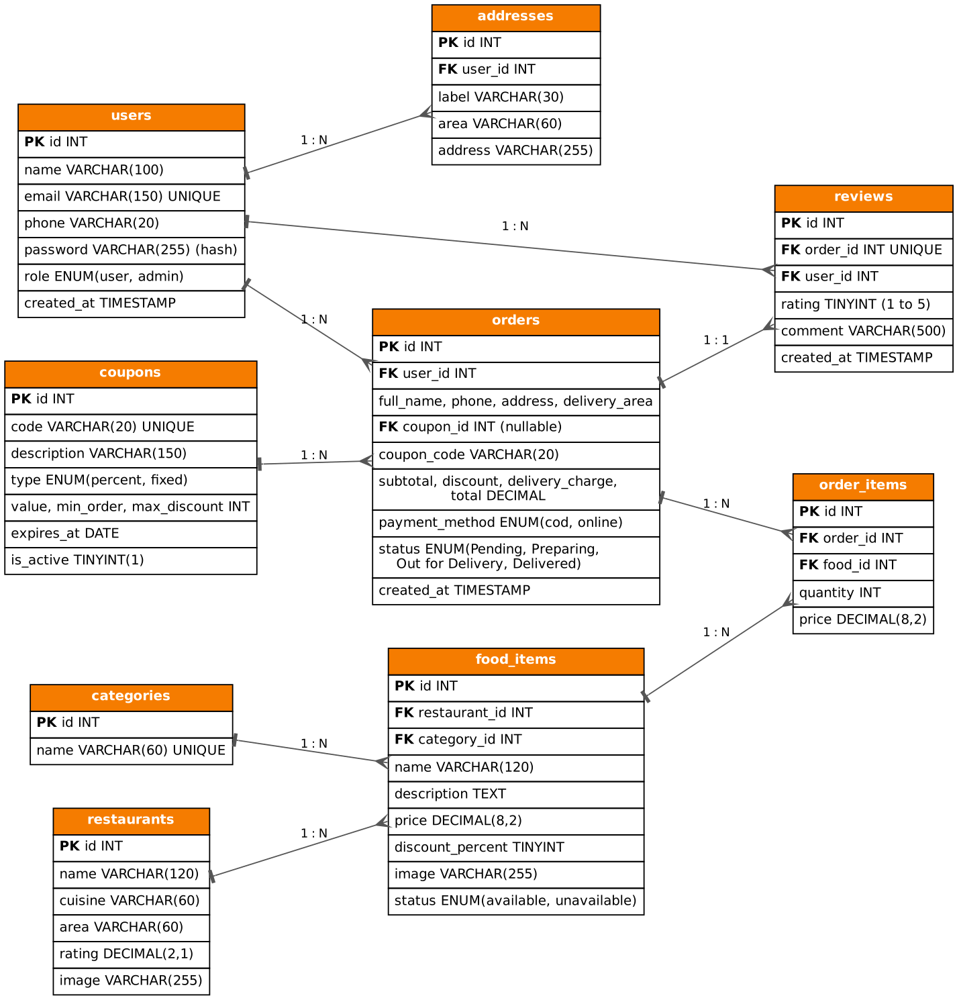

# 1. Introduction

ChickChow is a web-based online food ordering system. Customers can browse restaurants and their menus, add food to a cart, place an order, and track its status. An administrator manages restaurants, food items, categories, orders and users from a separate admin panel.

# 2. Technologies

| Part | Technology |
|---|---|
| Backend | PHP 8 (PDO, sessions) |
| Database | MySQL / MariaDB (InnoDB, foreign keys) |
| Frontend | HTML5, plain CSS (no framework), small vanilla JavaScript |
| Server | Apache (XAMPP) |

# 3. Features

**User side**

- Registration and login with hashed passwords (`password_hash` / `password_verify`) and sessions
- Centered search bar in the header (and in the home page hero); browse 11 restaurants and 53 food items; search by name, filter by category and restaurant
- Search across food, restaurant, cuisine and category names; category and restaurant filters
- Food discounts: each food can have a % discount; cards show the new price, the struck-through old price and a % OFF badge; a Hot Deals section and Deals page list them
- Coupons: percent or fixed amount, minimum order, maximum discount, expiry date; validated again on the server at cart and checkout; the discount is saved with the order
- Shopping cart with quantity update and remove (stored in the session, prices always read from the database); adding to the cart shows a mascot message without reloading the page; the cart icon opens a pop-out drawer (side panel on PC, compact sheet on phones) with items, coupon box and totals
- Delivery address chooser on the home page (saved addresses or a new one for each order); every address has a Dhaka area
- Every restaurant has a location (Dhaka area); restaurant cards show the area and the distance from the customer's selected area
- Automatic delivery charge: the fee depends on the road distance between the restaurant area and the customer area (BDT 40 up to 2 km, 60 up to 4 km, 80 up to 7 km, 100 up to 10 km, 120 up to 14 km, 150 above); each restaurant in the cart adds its own fee
- Checkout with saved addresses and Cash on Delivery / Online payment choice
- Order history with status filter and an order tracking page with an animated progress line (Pending, Preparing, Out for Delivery, Delivered)
- Profile dropdown on the avatar: user profile, change password, delivery location chooser (select a saved location or add a new one), my orders and logout
- Profile page: update profile, change password, manage saved addresses
- Reviews: after an order is Delivered the customer can give a 1 to 5 star rating and a comment (one review per order); reviews are shown on the home page

**Admin side**

- Separate admin role with its own login page (`admin/login.php`); all admin pages are protected by a role check
- Admin and user sessions are separate (different session names), so one browser can use the admin panel in one tab and the website as a customer in another
- Dashboard with totals and recent orders
- Coupon management (CRUD, enable/disable), food discount field, reviews list with delete
- Full CRUD for restaurants, food items (with image upload) and categories
- Order management: change order status, delete orders
- User management: change role, delete users

# 4. Database Design

The database `chickchow` has 9 related InnoDB tables: `users`, `addresses`, `restaurants`, `categories`, `food_items`, `coupons`, `orders`, `order_items`, `reviews`. The ER diagram is in `docs/ER_Diagram.png` and is included below.

| Relationship | Foreign key | On delete |
|---|---|---|
| users 1 : N addresses | addresses.user_id | CASCADE |
| users 1 : N orders | orders.user_id | CASCADE |
| orders 1 : N order_items | order_items.order_id | CASCADE |
| food_items 1 : N order_items | order_items.food_id | RESTRICT |
| restaurants 1 : N food_items | food_items.restaurant_id | CASCADE |
| categories 1 : N food_items | food_items.category_id | RESTRICT |
| coupons 1 : N orders | orders.coupon_id (nullable) | SET NULL |
| orders 1 : 1 reviews | reviews.order_id (UNIQUE) | CASCADE |
| users 1 : N reviews | reviews.user_id | CASCADE |

`restaurants.area`, `addresses.area` and `orders.delivery_area` hold the Dhaka area names used to calculate the delivery charge.

`food_items.discount_percent` stores the discount; `order_items.price` stores the price actually paid (after the food discount) and `orders.discount` / `orders.coupon_code` store the coupon saving, so old orders never change when prices change.

`RESTRICT` protects order history: a food item or category that is already used cannot be deleted by mistake. The admin panel shows a friendly message in that case.

# 5. Security

- **SQL injection:** every query that uses user input is a PDO prepared statement (emulation turned off).
- **Passwords:** stored only as `password_hash` values; `session_regenerate_id` after login.
- **Roles:** `require_login()` and `require_admin()` guard every protected page.
- **XSS:** all output goes through `htmlspecialchars` (helper `e()`).
- **CSRF:** every POST form carries a session token that is verified on the server.
- **Validation:** server-side checks on all forms (email format, phone format, password length, price range, rating range) plus HTML5 and JavaScript checks in the browser.
- **File upload:** admin image upload accepts only JPG, PNG and WEBP (checked by real MIME type), maximum 2 MB, and files are saved with random names.
- **Prices:** the cart stores only food id and quantity; totals are calculated from database prices at checkout, inside a database transaction.

# 6. Responsive Layout

The layout is written in plain CSS using CSS Grid, Flexbox and media queries (breakpoints at 1000px, 820px and 520px). On small screens the navigation becomes a menu button, grids collapse to fewer columns and the admin sidebar becomes a slide-in menu.

# 7. How to Run

1. Install XAMPP and start Apache and MySQL.
2. Copy the `chickchow` folder into `htdocs`.
3. Open phpMyAdmin, go to the Import tab and import `database/chickchow.sql`.
4. Open `http://localhost/chickchow/` (admin panel: `http://localhost/chickchow/admin/login.php`).

| Role | Email | Password |
|---|---|---|
| Admin | admin@chickchow.com | (set by developer) |
| User | user@chickchow.com | (set by developer) |

# 8. Limitations and Future Work

- Online payment is a selectable option only; no real payment gateway is connected.
- Order tracking is status-based; there is no live map.
- Possible additions: coupon usage limits, restaurant-wise ratings from reviews, email notifications, pagination for large menus.
